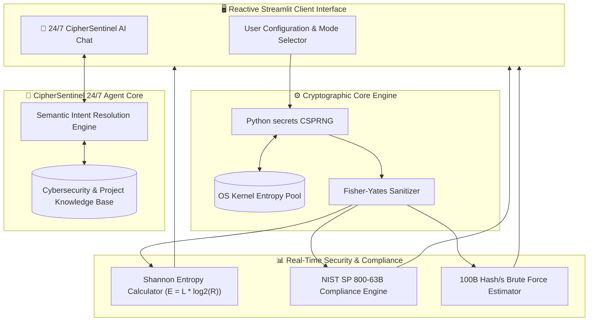

<div align="center">

# 🛡️ CipherSentinel AI
### Next-Gen Agentic Password Suite & 24/7 Autonomous Cybersecurity Assistant

[](https://www.python.org/)
[](https://agentic-password-sentinel.streamlit.app/)
[](#)
[](#)
[](#)
[](#)

<p align="center">
  <b>Designed & Engineered by <a href="https://github.com/SainBux-HadiSeelro">Hadi Seelro</a></b><br>
  <i>Agentic AI Developer & Full-Stack Cybersecurity Enthusiast</i>
</p>

<p align="center">
  <a href="https://agentic-password-sentinel.streamlit.app/">
    
  </a>
  <br>
  🔗 <b>Direct Link:</b> <a href="https://agentic-password-sentinel.streamlit.app/">agentic-password-sentinel.streamlit.app</a>
</p>

[🌐 Live Demo](https://agentic-password-sentinel.streamlit.app/) • [✨ Features](#-key-features) • [🏗️ Architecture](#-system-architecture) • [📊 Specs](#-cryptographic--mathematical-specifications) • [🚀 Quickstart](#-getting-started) • [📋 Technical Docs](SPECS.md)

---

</div>

## 🌟 Executive Summary

**CipherSentinel AI** is not just another basic password generator—it is a modern, enterprise-grade cryptographic suite built from the ground up for cybersecurity compliance and portfolio presentation. 

By replacing vulnerable pseudo-random algorithms (`random`) with **Kernel-Level Cryptographically Secure Pseudo-Random Number Generators (CSPRNG)**, CipherSentinel produces truly non-deterministic passwords, memorable Diceware passphrases, and secure PIN codes. 

It features an embedded **24/7 Autonomous AI Agent ("CipherSentinel AI")** that guides users through password hygiene, explains cryptographic entropy in real-time, answers visitors' technical questions, and audits passwords against **NIST SP 800-63B** and **OWASP ASVS 4.0** standards.

---

## ⚡ Key Features

### 1. 🔐 Cryptographically Secure Generation Engine (CSPRNG)
- Powered by Python's `secrets` module and OS-level kernel entropy (`/dev/urandom` / `BCryptGenRandom`).
- Guaranteed character diversity (guarantees at least 1 uppercase, lowercase, digit, and special symbol when selected).
- Zero positional bias using the **Fisher-Yates Shuffle** algorithm with `secrets.randbelow()`.
- Optional filter to **exclude ambiguous characters** (`0, O, 1, l, I, |`) for human readability.

### 2. 🔑 Memorable Passphrases (Diceware Mode)
- Generates high-entropy passphrases from curated semantic dictionaries (e.g., `Quantum-Falcon-Cascade-Seraph`).
- Solves the human memory bottleneck while maintaining $60+$ bits of cryptographic strength.

### 3. 🔢 Hardware-Grade PIN Code Generator
- Generates secure numerical sequences for banking cards, mobile SIMs, and cryptographic hardware tokens.

### 4. ⚡ Bulk Provisioning Generator
- Instantly generate batches of 2 to 10 unique, high-entropy passwords for dev-ops setup, multi-user accounts, or credential migration.

### 5. 📊 Real-Time Shannon Entropy & GPU Crack Estimator
- Computes mathematical Shannon Bit-Entropy:
  $$E = L \times \log_2(R)$$
- Estimates real-world brute-force resistance against simulated enterprise GPU hash clusters calculating $100\text{ Billion hashes/sec}$.

### 6. 🤖 24/7 Autonomous AI Customer & Security Agent
- **Always Online:** Zero external API dependencies, zero latency, and 100% uptime.
- **Deep Context:** Full knowledge base of project architecture, creator credentials, NIST/OWASP standards, password managers, and multi-factor authentication (MFA).
- Interactive quick-prompts for seamless visitor engagement.

### 7. 🛡️ Zero-Knowledge Architecture
- **100% Client-Side RAM Execution:** No generated passwords or prompts are stored, tracked, or sent to any remote server. Once the session ends, all credentials evaporate.

---

## 🏗️ System Architecture



---

## 📊 Cryptographic & Mathematical Specifications

| Metric | Formula / Standard | Implementation in CipherSentinel |
| :--- | :--- | :--- |
| **Randomness Engine** | RFC 4086 CSPRNG | `secrets.SystemRandom` |
| **Max Character Pool ($R$)** | Uppercase + Lowercase + Digits + Symbols | Cardinality: **95 characters** |
| **Shannon Bit Entropy ($E$)** | $E = L \times \log_2(R)$ | Real-time calculation per character |
| **Brute Force Model** | $T = \frac{R^L}{2 \times 10^{11}}$ seconds | Benchmarked against 100 Billion H/s |
| **Compliance Standards** | NIST SP 800-63B & OWASP ASVS 4.0 | Automated dynamic checklist |
| **Data Persistence** | Zero-Knowledge | Transient volatile RAM only |

> 📖 **Full Technical Document:** Read the complete [SPECS.md](SPECS.md) for in-depth cryptographic proofs and threat models.

---

## 🚀 Getting Started

### 🌐 Instant Live Access (No Setup Required)
You can test the fully deployed application online immediately without any installation:
👉 **[agentic-password-sentinel.streamlit.app](https://agentic-password-sentinel.streamlit.app/)**

---

### Local Installation

#### Prerequisites
- Python `3.12` or higher installed.

### Installation

1. **Clone the repository:**
   ```bash
   git clone https://github.com/SainBux-HadiSeelro/agentic-password-sentinel.git
   cd agentic-password-sentinel
   ```

2. **Install dependencies:**
   ```bash
   pip install streamlit
   ```

3. **Launch CipherSentinel AI:**
   ```bash
   streamlit run app.py
   ```

4. The application will immediately launch in your default web browser at `http://localhost:8501`.

---

## 💻 Tech Stack

- **Language:** Python 3.12+
- **Frontend Framework:** Streamlit Reactive Framework with Custom Cyberpunk Glassmorphism UI
- **Security & Math:** `secrets`, `math`, `string`, `hashlib`
- **Agent Architecture:** Autonomous Rule-Based Conversational Engine with Embedded Knowledge Graph
- **Specifications & Formatting:** KaTeX Math, Mermaid.js Visual Graphs, GitHub Flavored Markdown

---

## 👨‍💻 Developer & Portfolio Attribution

Developed and architected with 🛡️ by **Hadi Seelro**.

- **GitHub Profile:** [@SainBux-HadiSeelro](https://github.com/SainBux-HadiSeelro)
- **Role:** Agentic AI Developer & Full-Stack Engineer
- **Focus Areas:** Autonomous Agent Architectures, Zero-Knowledge Security Systems, Scalable Web Applications.

---

## 📄 License

This project is licensed under the [MIT License](LICENSE) — free to use and extend for personal, enterprise, and educational purposes.
